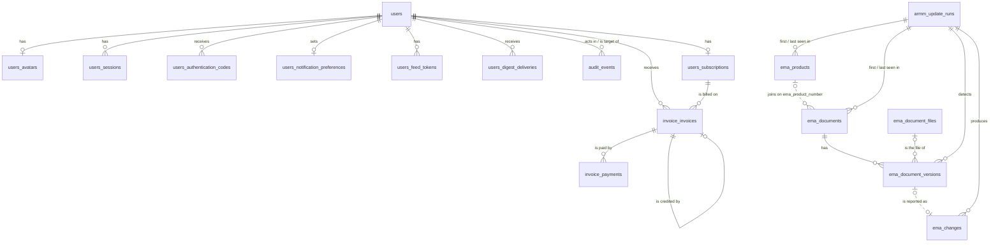

# Data model: design

This document describes **every table** in aRMM Alerts database in one place: columns, keys, relationships, cascades
and retention. It's the reference for the schema. The other design documents describe the behaviour around
these tables (flows, rules, pages) and link here for the columns.

The tables are stored in PostgreSQL (users.md §4); the SQL is in `src/lib/server/db/migrations.ts`.

## 1. Conventions

- **Names**: tables and columns are `snake_case`. In TypeScript the same fields
  are `camelCase` (`first_name` ↔ `firstName`); the storage layer converts them (users.md §4.3).
- **IDs** are UUIDs, never sequential numbers, and are never derived from other data. The design asks for
  UUIDv7 (sortable by creation time); the code currently uses `crypto.randomUUID()` (v4), which is equally
  unguessable but not sortable.
- **Timestamps** are `timestamptz`, stored in UTC; dates without a time are `date`. Times shown to people are
  in `Europe/Amsterdam`.
- **Emails** are stored lowercased and trimmed (`citext`).
- **Secrets** (session tokens, sign-in codes, feed tokens) are only stored as SHA-256 hashes, so a data leak
  doesn't let anyone sign in or read a feed.
- **Customer data**: every table with customer data has `user_id`, and is only read through functions that
  take the user first (users.md §6). There's no organisations table: each user is a customer with their own
  organisation, stored on the user's row.
- **Money** is an `integer` number of euro cents, never a float. VAT is computed per invoice and stored.
- **Enums** are text with a fixed list of values, checked in code (a check constraint in PostgreSQL).
- **Null**: every column is always present; "no value" is `null`, never a missing field.
- **jsonb** is only used for small, self-contained data that's never queried by its contents (audit
  metadata, change details, invoice snapshots).

## 2. Overview

Solid lines are foreign keys; dotted lines are joins without one (`ema_documents.ema_product_number`, and a
change's `entity_ref`).

| Table | Holds | Key | Code type | Status |
| --- | --- | --- | --- | --- |
| [`users`](#31-users) | Accounts with their organisation | `id` | `User` (auth.ts) | Built |
| [`users_avatars`](#32-users_avatars) | Profile pictures (base64) | `user_id` | `Avatar` (auth.ts) | Built |
| [`users_sessions`](#33-users_sessions) | Signed-in sessions | `token_hash` | `Session` (auth.ts) | Built |
| [`users_authentication_codes`](#34-users_authentication_codes) | One-time email codes | `id` | `AuthCode` (auth.ts) | Built |
| [`users_notification_preferences`](#35-users_notification_preferences) | Digest and RSS settings | `user_id` | `NotificationPreferences` (store.ts) | Built |
| [`users_feed_tokens`](#36-users_feed_tokens) | Secret RSS feed URLs | `token_hash` | `FeedToken` (store.ts) | Built |
| [`users_digest_deliveries`](#37-users_digest_deliveries) | Sent digest emails | `id` | — | Designed |
| [`ema_products`](#41-ema_products) | EMA medicines, current state | `ema_product_number` | — | Designed |
| [`ema_documents`](#42-ema_documents) | EPAR documents, current state | `id` | — | Designed |
| [`ema_changes`](#43-ema_changes) | Changes customers are alerted about | `id` | — | Designed |
| [`ema_document_versions`](#44-ema_document_versions) | Version history of the documents, kept forever | `id` | — | Designed |
| [`ema_document_files`](#45-ema_document_files) | Archived document files (PDF etc.), kept forever | `sha256` | — | Designed |
| [`armm_update_runs`](#51-armm_update_runs) | Runs of the aRMM update process | `id` | `UpdateRun` (store.ts) | Built |
| [`audit_events`](#61-audit_events) | Audit log | `id` | `AuditEvent` (store.ts) | Built |
| [`users_subscriptions`](#71-users_subscriptions) | Licences | `id` | `Subscription` (store.ts) | Built |
| [`invoice_invoices`](#72-invoice_invoices) | Invoices and credit notes | `id` | — | Designed |
| [`invoice_payments`](#73-invoice_payments) | Received bank transfers | `id` | — | Designed |
| [`invoice_counters`](#74-invoice_counters) | Last invoice number per year | `year` | — | Designed |

"Key" is the primary key; the unique constraints are in §8. "Designed" tables have no SQL migration yet.

## 3. Users

### 3.1 `users`
One row per person, identified by their email address. Every user is a customer with their own
organisation, whose details are columns on this row. Behaviour: users.md §5.1, §7, §8.

**The person** (part of users table)

| Column | Type | Notes |
| --- | --- | --- |
| `id` | uuid PK | |
| `email` | citext, unique, not null | Sign-in identifier. Unique among users that aren't deleted. |
| `email_verified_at` | timestamptz, null | Set the first time a code sent to this address is verified. |
| `first_name` | text, not null | 1–100 characters. Used in email greetings ("Hi Jane,"). |
| `last_name` | text, not null | 1–100 characters. The UI shows the full name as first name, space, last name. |
| `status` | enum `active` \| `suspended` \| `deleted`, not null | A suspended user can't sign in at all. Deleted: anonymised after 30 days ([gdpr.md](gdpr.md) §5). |
| `locale` | text, null | Language of emails and the UI, e.g. `nl-NL`. Falls back to `nl-NL`. |
| `avatar_updated_at` | timestamptz, null | Set when a profile picture is uploaded ([§3.2](#32-users_avatars)), null when there's none. Added to the image URL (`?v=…`) so browsers fetch the new picture. |
| `last_sign_in_at` | timestamptz, null | |
| `terms_accepted_at` / `terms_version` | timestamptz / text, null | Terms of service and privacy notice accepted ([gdpr.md](gdpr.md) §2). |
| `created_at` / `updated_at` | timestamptz, not null | |
| `deleted_at` | timestamptz, null | |

**Their organisation** (part of users table)

| Column | Type | Notes |
| --- | --- | --- |
| `organization_name` | text, null | 1–100 characters. Null until the organisation is set up on the account page (users.md §8.1); the app can't be used until then. |
| `legal_name` | text, null | Registered company name, e.g. "Acme Security B.V.". Required before the first invoice. |
| `registration_number` | text, null | KvK number. Required before the first invoice. |
| `vat_number` | text, null | E.g. `NL123456789B01`. Stored uppercase without spaces. Optional. |
| `contact_email` | citext, null | For service messages, e.g. planned maintenance. |
| `billing_email` | citext, null | Where invoices go; falls back to `email`. |
| `phone` | text, null | E.164, e.g. `+31201234567`. |
| `address_line1` / `address_line2` | text, null | Street and number; floor, suite, "c/o". |
| `postal_code` / `city` / `region` | text, null | Postal code stored uppercase (`1234 AB` for NL). |
| `country_code` | text, null, check `^[A-Z]{2}$` | ISO 3166-1 alpha-2, chosen from a list. If any address field is set, `address_line1`, `city` and `country_code` are required. |
| `dpa_accepted_at` / `dpa_version` | timestamptz / text, null | Data processing agreement, accepted together with setting `organization_name`. |

### 3.2 `users_avatars`
The profile picture, stored as a base64 string. Always a 256 × 256 WebP made on the server, never the
uploaded file. Kept apart from `users` so reading a user never loads the picture. Behaviour: users.md §5.4.

| Column | Type | Notes |
| --- | --- | --- |
| `user_id` | uuid PK, FK → users | One picture per user. |
| `content_type` | text, not null | Always `image/webp`. |
| `data` | text, not null | The WebP, base64-encoded (about 10–20 KB of text). |
| `updated_at` | timestamptz, not null | Same value as `users.avatar_updated_at`. |

### 3.3 `users_sessions`
A signed-in browser. Stores current user sessions.

| Column | Type | Notes |
| --- | --- | --- |
| `id` | uuid, unique | Used to list and revoke sessions without exposing the token. |
| `user_id` | uuid FK → users, not null | |
| `token_hash` | bytea PK | SHA-256 of the cookie token. Sessions are looked up by hash. |
| `created_at` / `expires_at` | timestamptz, not null | `expires_at = created_at + 5 days`; activity doesn't extend it. |
| `last_seen_at` | timestamptz, not null | Updated at most every 5 minutes. |
| `user_agent` | text, null | Shown as "Chrome on Windows". |
| `ip_address` | inet, null | Truncated after 30 days. |
| `revoked_at` | timestamptz, null | Set on sign-out or revocation; the row is kept until retention removes it. |

### 3.4 `users_authentication_codes`
A 6-digit code sent by email.
Only one unconsumed code per `(email, purpose)` is valid at a time; issuing a new one invalidates the old.
Rows older than 24 hours are deleted by a scheduled job.

| Column | Type | Notes |
| --- | --- | --- |
| `id` | uuid PK | |
| `email` | citext, not null | Where the code was sent; may not have an account yet (sign-up). |
| `purpose` | enum `sign_in` \| `sign_up` \| `change_email` \| `confirm_deletion`, not null | A code only works for its own purpose. |
| `code_hash` | bytea, not null | SHA-256 of the code. |
| `attempts` | smallint, default 0 | The code is invalid after 5 wrong attempts. |
| `pending_first_name` / `pending_last_name` / `terms_version` | text, null | For `sign_up`: the account is created with these once the code is verified. |
| `user_id` | uuid FK → users, null | For `change_email` and `confirm_deletion`. |
| `created_at` / `expires_at` | timestamptz, not null | 10-minute lifetime. |
| `consumed_at` | timestamptz, null | Set on success; a code can be used once. |

### 3.5 `users_notification_preferences`
How a customer receives changes besides the app. Created when the organisation is set up. 

| Column | Type | Notes |
| --- | --- | --- |
| `user_id` | uuid PK, FK → users | |
| `email_frequency` | enum `off` \| `daily` \| `weekly`, default `weekly` | |
| `weekly_day` | smallint 1–7, default `1` | ISO weekday, 1 = Monday. |
| `send_time` | time, default `08:00` | Amsterdam time. |
| `send_when_empty` | boolean, default `false` | |
| `rss_enabled` | boolean, default `false` | |
| `updated_at` | timestamptz, not null | |

### 3.6 `users_feed_tokens`
The secret URL of a customer's RSS feed. At most one is active per user.

| Column | Type | Notes |
| --- | --- | --- |
| `id` | uuid, unique | |
| `user_id` | uuid FK → users, not null | |
| `token_hash` | bytea PK | SHA-256 of the token in the URL (32 random bytes). |
| `created_at` | timestamptz, not null | |
| `last_used_at` | timestamptz, null | Updated at most once an hour. |
| `revoked_at` | timestamptz, null | |

### 3.7 `users_digest_deliveries`
**Not built yet.** One digest email for one period, so a period is never sent twice or skipped.

| Column | Type | Notes |
| --- | --- | --- |
| `id` | uuid PK | Also sent to Resend as the `Idempotency-Key`. |
| `user_id` | uuid FK → users, not null | |
| `frequency` | enum `daily` \| `weekly`, not null | |
| `period_start` / `period_end` | timestamptz, not null | Changes with `created_at` in `[period_start, period_end)`. |
| `change_count` | integer, not null | |
| `status` | enum `pending` \| `sent` \| `failed` \| `skipped_empty`, not null | |
| `attempts` | smallint, not null | Up to 5. |
| `provider_message_id` | text, null | Resend email ID. |
| `created_at` | timestamptz, not null | |
| `sent_at` | timestamptz, null | |

## 4. EMA Products

### 4.1 `ema_products`
The current state of every EMA medicine: one row per record in EMA's medicines file
(`medicines-output-medicines_json-report_en.json`), human and veterinary, whatever its status. Upserted on
every run; changes to the fields marked **tracked** are recorded in [`ema_changes`](#43-ema_changes). Not
customer data and not personal data.

Columns have the same names as the fields in EMA's file, so the mapping is one to one. EMA's values are all
strings; the import converts them:

- empty strings (`""`) become `null`, and leading and trailing spaces are trimmed (85 values have them);
- dates are `dd/mm/yyyy` and become `date`;
- `"Yes"` / `"No"` become `boolean`;
- `;`-separated lists stay as text as EMA sends them (e.g. `Hypercholesterolemia;Dyslipidemias`).

Figures are from the file of 26-10-2026 (`meta.timestamp` 2026-10-26T06:02:46Z, 2,754 records).

**Identity and status**

| Column | Type | Notes |
| --- | --- | --- |
| `ema_product_number` | text PK | E.g. `EMEA/H/C/005392`. `EMEA/H/` = human, `EMEA/V/` = veterinary. Unique and stable; the key EMA's documents file joins on. An exception to the UUID rule (§1): it's EMA's key, never one we make. |
| `category` | enum `Human` \| `Veterinary`, not null | 2,357 / 397. |
| `name_of_medicine` | text, not null | Up to 125 characters. Not unique (2,702 distinct names): refused and re-submitted applications share names. May contain `(previously …)`. |
| `medicine_status` | enum, not null | `Authorised`, `Withdrawn`, `Application withdrawn`, `Refused`, `Opinion`, `Lapsed`, `Expired`, `Revoked`, `Suspended`, `Withdrawn from rolling review`, `Opinion under re-examination`. **Tracked.** An unknown value fails the import, so a new EMA status is noticed. |
| `opinion_status` | enum `Positive` \| `Negative`, null | CHMP/CVMP opinion; only set for 53 records. |
| `marketing_authorisation_developer_applicant_holder` | text, null | The MAH, e.g. `Novartis Europharm Limited`. Null for 350 records (mostly applications that never got an authorisation). **Tracked.** |
| `medicine_url` | text, not null | EPAR page on ema.europa.eu. Unique. |

**Substance and classification**

| Column | Type | Notes |
| --- | --- | --- |
| `active_substance` | text, null | Up to 804 characters; `;`-separated for combinations (365 records). **Tracked.** |
| `international_non_proprietary_name_common_name` | text, null | INN. Up to 383 characters. |
| `atc_code_human` | text, null | E.g. `J02AC03`; `;`-separated for 4 records. EMA's `Not yet assigned` (6 records) becomes `null`. **Tracked.** |
| `atcvet_code_veterinary` | text, null | E.g. `QI02AD11`. Veterinary only (68 records). **Tracked.** |
| `pharmacotherapeutic_group_human` | text, null | E.g. `Lipid modifying agents`. |
| `pharmacotherapeutic_group_veterinary` | text, null | |
| `therapeutic_area_mesh` | text, null | `;`-separated MeSH terms. |
| `species_veterinary` | text, null | `;`-separated target species, e.g. `Pigs;Cattle;Sheep`. Veterinary only. |
| `therapeutic_indication` | text, null | Up to ~9,000 characters. HTML entities (`&nbsp;`, `&lt;`, `&gt;`) are decoded on import; there are no HTML tags. **Tracked.** |

**Flags** (all `boolean`, not null, from `"Yes"` / `"No"`; the count is the number of `Yes`)

| Column | Notes |
| --- | --- |
| `additional_monitoring` | Black triangle ▼ (472). **Tracked.** |
| `orphan_medicine` | 256 |
| `generic` | 396 |
| `biosimilar` | 196 |
| `conditional_approval` | 59. **Tracked.** |
| `exceptional_circumstances` | 65 |
| `accelerated_assessment` | 49 |
| `advanced_therapy` | 36 |
| `prime_priority_medicine` | PRIME (46) |
| `patient_safety` | 2 |

**Procedure and dates** (all `date`, null unless noted)

| Column | Notes |
| --- | --- |
| `revision_number` | `smallint`, null. EPAR revision. **Tracked.** |
| `latest_procedure_affecting_product_information` | `text`, null. E.g. `VR/0000369223` or `PSUSA/00010967/202403`; sometimes two, separated by `; `. **Tracked**: a new value means the product information changed. |
| `marketing_authorisation_date` | |
| `european_commission_decision_date` | Latest EC decision. **Tracked.** |
| `opinion_adopted_date` | |
| `start_of_evaluation_date` | |
| `start_of_rolling_review_date` | |
| `withdrawal_of_application_date` | |
| `refusal_of_marketing_authorisation_date` | |
| `withdrawal_expiry_revocation_lapse_of_marketing_authorisation_date` | |
| `suspension_of_marketing_authorisation_date` | |
| `first_published_date` | `date`, not null. When the EPAR page was first published. |
| `last_updated_date` | When EMA last changed the EPAR page. Null for 91 records. |

**Bookkeeping** (set by the import, not by EMA)

| Column | Type | Notes |
| --- | --- | --- |
| `raw` | jsonb, not null | The full EMA record as received, so a field EMA adds later isn't lost before it gets a column. |
| `first_seen_run_id` | uuid FK → armm_update_runs, not null | The run that first imported the product. |
| `last_seen_run_id` | uuid FK → armm_update_runs, not null | The last run in which the product was in EMA's file. |
| `removed_at` | timestamptz, null | Set when the product is no longer in EMA's file; cleared if it comes back. Rows are never deleted. |
| `created_at` / `updated_at` | timestamptz, not null | |

Indexes: `name_of_medicine`, `marketing_authorisation_developer_applicant_holder`, `atc_code_human`,
`medicine_status`, for filtering.

### 4.2 `ema_documents`

The current state of every EPAR document: one row per record in EMA's documents file
(`documents-output-epar_documents_json-report_en.json`). Upserted on every run; changes to the fields
marked **tracked** are recorded in [`ema_changes`](#43-ema_changes), for the monitored types only (see
`type`). Not customer data and not personal data.

As in `ema_products`, columns have the same names as the fields in EMA's file (except EMA's `id`, stored as
`ema_document_id` because `id` is our uuid), empty strings become `null` and
leading and trailing spaces are trimmed (307 values have them, 46 of them in `ema_product_number`).

Figures are from the file of 26-10-2026 (`meta.timestamp` 2026-10-26T05:50:10Z, 20,317 records).

**EMA overwrites the file.** A new version of a document keeps its EMA id (`ema_document_id`) and its `document_url`; only
`last_updated_date` changes, and the old file is gone. So this table only ever holds the latest version, and a
change of `last_updated_date` is how a new version is detected.

| Column | Type | Notes |
| --- | --- | --- |
| `id` | uuid PK | Our own id, generated when the document is first imported (§1). Every document has a unique uuid; other tables refer to the document by it. |
| `ema_document_id` | text, not null, unique | EMA's document id (`id` in EMA's file), e.g. `2410`. Unique and stable; the import matches records on it. Numeric, but stored as text because it's EMA's key, not a number we calculate with. |
| `ema_product_number` | text, null | The product the document belongs to; joins on [`ema_products`](#41-ema_products). **No foreign key**: after trimming, 7 documents have no matching product (6 for `EMEA/H/C/005152`, 1 without a number), and EMA's two files aren't published at exactly the same moment. Null for that one document. Indexed. |
| `medicine_name` | text, null | Product name as given in the documents file; up to 125 characters. |
| `name` | text, not null | Document title, e.g. `Padcev : EPAR - Product information`. Up to 243 characters. Not unique. |
| `type` | enum, not null | One of 18 values, see below. **Tracked.** An unknown value doesn't fail the import: the document is stored, isn't monitored, and the run gets a warning, so a new EMA type is noticed. |
| `status` | enum `Adopted` \| `Draft` \| `unknown`, not null | EMA's value as is; `unknown` (15,228) is EMA's own value, not a missing one. **Tracked.** |
| `reference_number` | text, null | EMA document reference, e.g. `EMA/CHMP/261595/2012`. Set for 7,703 documents; up to 97 characters, sometimes free text. |
| `first_published_date` | timestamptz, not null | ISO 8601 UTC (`2009-06-08T02:09:21Z`). |
| `last_updated_date` | timestamptz, null | ISO 8601 UTC. **Tracked**: a different value means EMA published a new version. Null for 23 documents (overviews and presentation lists), which can then only change by URL. |
| `consultation_date` | date, null | Always empty in the current file; kept so the mapping stays complete. |
| `document_url` | text, not null, unique | English version on `www.ema.europa.eu`. Up to 265 characters. Mostly PDF (19,878); also `.docx`, `.doc`, `.xls`, and URLs ending in `.pdf-0`, so the file type is taken from the response, not the URL. **Tracked.** |
| `translations` | jsonb, null | `{ "<language>": "<url>" }` for up to 25 languages (`bg` … `sv`, plus `is`, `no`, `ga`); never `en`. Only 7,217 documents have it; EMA leaves the field out for the rest, which becomes `null`. Not tracked. |

**Bookkeeping**: `raw`, `first_seen_run_id`, `last_seen_run_id`, `removed_at`, `created_at` / `updated_at`, as in
`ema_products`.

**Document types** (`type`), with the number of documents. Changes to the monitored types are what customers
are alerted about:

| `type` | Documents | Monitored | Meaning |
| --- | --- | --- | --- |
| `product-information` | 2,221 | yes | SmPC, Annex II, labelling and package leaflet (PIL) in one file. |
| `rmp` | 797 | yes | Risk management plan, incl. the aRMM measures. |
| `rmp-summary` | 679 | yes | Summary of the RMP. |
| `product-information-tracked-changes` | 330 | no | The PI with tracked changes; shown next to a PI change. |
| `variation-report` | 3,343 | no | Context: why something changed. |
| `procedural-steps-after` | 3,241 | no | Context. |
| `overview` | 2,225 | no | EPAR summary for the public. |
| `all-authorised-presentations` | 2,221 | no | |
| `assessment-report` | 1,797 | no | |
| `scientific-conclusion` | 1,623 | no | |
| `scientific-discussion` | 504 | no | |
| `procedural-steps-before` | 484 | no | |
| `orphan-maintenance-report` | 193 | no | |
| `scientific-discussion-variation` | 191 | no | |
| `steps-after-cutoff` | 170 | no | |
| `pip-compliance` | 124 | no | |
| `conditions-member-states` | 114 | no | |
| `orphan-maintenance-report-post` | 60 | no | |

A product usually has one document per monitored type, but not always: some have two `product-information`
or up to three `rmp-summary` documents. So a document is always identified by its `id` (or EMA's
`ema_document_id`), never by `(ema_product_number, type)`.

Indexes: `(ema_product_number, type)`, `last_updated_date`.

### 4.3 `ema_document_versions`

The version history of each document: one row per version of an [`ema_documents`](#42-ema_documents) row
that the import has seen. EMA keeps no history and overwrites the file at the same URL (§4.2), so this table
is the only record of earlier versions, starting at the first import, and is **kept forever** (§9). Rows are only ever inserted, except that
the archive fills in `file_sha256` / `file_error` afterwards.

| Column | Type | Notes |
| --- | --- | --- |
| `id` | uuid PK | |
| `document_id` | uuid FK → ema_documents, not null | The document's uuid `id`. |
| `ema_product_number` | text, null | Copied from the document at detection, so the history of a product stays complete if a document is later moved to another product. |
| `type` | text, not null | Copied from the document at detection. |
| `version_kind` | enum `baseline` \| `new` \| `updated` \| `removed`, not null | `baseline`: present at the very first import, so it's unknown when it appeared. `new`: an `ema_document_id` seen for the first time after that. `updated`: a different `last_updated_date` (or `document_url`). `removed`: gone from EMA's file. |
| `last_updated_date` | timestamptz, null | EMA's `last_updated_date` of this version: when EMA published it. Null for the few documents without one (§4.2). |
| `document_url` | text, not null | The URL at the time. |
| `detected_run_id` | uuid FK → armm_update_runs, not null | The run that found this version. |
| `detected_at` | timestamptz, not null | |
| `latest_procedure` | text, null | `ema_products.latest_procedure_affecting_product_information` at detection, e.g. `VR/0000336191`, so a PI change shows which procedure caused it. |
| `revision_number` | smallint, null | `ema_products.revision_number` at detection. |
| `file_sha256` | bytea FK → ema_document_files, null | The archived file of this version (§4.5). Null until downloaded, and for types that aren't archived. |
| `file_error` | text, null | Why the file couldn't be archived, e.g. `superseded` or `HTTP 404`. |

- Unique on `(document_id, last_updated_date, document_url)` with `nulls not distinct`, so running the import
  twice never records the same version twice, also for documents without a `last_updated_date`, whose new
  versions can only be told apart by URL.
- A version of a monitored type (`version_kind` `new`, `updated` or `removed`) also produces an
  [`ema_changes`](#43-ema_changes) row in the same transaction. `baseline` versions don't, so customers don't get
  thousands of alerts after the first import.
- Indexes: `(document_id, last_updated_date desc)` for a document's history; `(ema_product_number,
  last_updated_date desc)` for a product's history; `file_sha256` where it's null, for the archive's to-do list.

### 4.4 `ema_document_files`

The archived files, stored in PostgreSQL. A file is stored once per content: the key is the SHA-256 of its
bytes, so if EMA republishes an identical file, the new version points to the existing row.

| Column | Type | Notes |
| --- | --- | --- |
| `sha256` | bytea PK | SHA-256 of `content`. |
| `content` | bytea, not null | The file as downloaded. Storage set to `EXTERNAL`: PDFs are already compressed, so PostgreSQL shouldn't try again. |
| `content_type` | text, not null | From the response, checked against the content: `application/pdf` (starts with `%PDF-`), or the Word/Excel types. Not from the URL, which can end in `.pdf-0` (§4.2). |
| `size_bytes` | integer, not null | 1–3 MB is typical for a PI or RMP. |
| `source_url` | text, not null | Where it was first downloaded. |
| `downloaded_at` | timestamptz, not null | |

### 4.5 `ema_changes`
One changed record in the ema_products database. Kept for **7 years** (§9). 

| Column | Type | Notes |
| --- | --- | --- |
| `id` | uuid PK | Also the RSS `<guid>`. |
| `update_run_id` | uuid FK → armm_update_runs, not null | |
| `change_type` | enum `created` \| `updated` \| `deleted`, not null | |
| `entity_type` | enum `ema_product` \| `ema_document`, not null | Which table the changed record is in: [`ema_products`](#41-ema_products) or [`ema_documents`](#42-ema_documents). A new source adds its own values. |
| `entity_ref` | text, not null | The key of that record: `ema_product_number` (e.g. `EMEA/H/C/005392`) for `ema_product`, the document's uuid `id` for `ema_document`. |
| `title` | text, not null | Short description, used in the app, digests and feeds. |
| `summary` | text, null | One or two sentences; shown in digests and RSS. |
| `details` | jsonb, null | `{ "fields": [{ "field", "from", "to" }] }`; shown only in the app. For `ema_document` also `ema_document_id`, `product_number`, `product_name`, `type`, `document_version_id`, `last_updated_date` and `document_url`. |
| `changed_at` | timestamptz, not null | When it happened (the run's `run_finished_at`). |
| `created_at` | timestamptz, not null | When it was recorded; digest periods use this. |

Which events become a change, per `entity_type`:

| `entity_type` | `change_type` | When |
| --- | --- | --- |
| `ema_product` | `created` | A new product in EMA's medicines file (not on the first import). |
| `ema_product` | `updated` | One or more **tracked** fields changed (§4.1); one row per product per run, all fields in `details.fields`. |
| `ema_product` | `deleted` | The product is no longer in EMA's file. |
| `ema_document` | `created` | A new document of a monitored type (§4.2) (not on the first import). |
| `ema_document` | `updated` | A **tracked** field of a monitored document changed (§4.2): a new version (`last_updated_date` or `document_url`, §4.4), or its `status` or `type`. |
| `ema_document` | `deleted` | A monitored document is no longer in EMA's file. |

**Which files are archived**: every version of the monitored types (`product-information`, `rmp`,
`rmp-summary`) and of `product-information-tracked-changes`, which is needed to show what changed in a PI.
Other types aren't archived; their versions are recorded in `ema_document_versions` without a file.

**When a file can still be archived.** EMA overwrites the file, so a version can only be downloaded while it's
still the current one: the document's `last_updated_date` must still equal the version's. A version that's been
overtaken before its file was downloaded gets `file_error = 'superseded'` and is never retried; downloading it
later would store the next version under the wrong row. A failed download that isn't superseded is retried on
the next run.

**Size.** The first import archives the current files of the archived types: about 4,000 files (on 26-10-2026:
2,221 PI, 797 RMP, 679 RMP summary, 330 tracked changes), 4–8 GB. After that about 50–60 files a week,
5–8 GB a year. Files are **kept forever** (§9) and the table is append-only, so it only grows; it can be
backed up separately from the rest of the database.

## 5. aRMM Alert runs

### 5.1 `armm_update_runs`
One run of the separate process that edits the aRMM database twice a day. Behaviour: armm-database.md §2.

| Column | Type | Notes |
| --- | --- | --- |
| `id` | uuid PK | |
| `source_run_id` | text, unique, not null | The run's ID or timestamp from the update process; prevents processing a run twice. |
| `run_finished_at` | timestamptz, not null | When the update process finished. |
| `status` | enum `pending` \| `processing` \| `done` \| `failed`, not null | |
| `change_count` | integer, not null | |
| `error` | text, null | Short description when `failed`; never personal data. |
| `attempts` | smallint, not null | |
| `started_at` / `finished_at` | timestamptz, null | When aRMM Alerts processed the run. |

## 6. Audit

### 6.1 `audit_events`
Security-relevant events, append-only: rows are only ever inserted.

| Column | Type | Notes |
| --- | --- | --- |
| `id` | uuid PK | |
| `actor_user_id` | uuid, null | Who did it; null for the system or anonymous. Not a foreign key: events outlive accounts. |
| `target_user_id` | uuid, null | Who it was done to. |
| `type` | text, not null | `area.action`, one of the types in audits.md §3. |
| `metadata` | jsonb, not null | Small, non-sensitive details, e.g. changed field names. Never codes, tokens or payment details. |
| `ip_address` | inet, null | Truncated after 30 days. |
| `created_at` | timestamptz, not null | |

## 7. Billing

### 7.1 `users_subscriptions`
The customer's licence. Created as `trialing` when the organisation is set up.

| Column | Type | Notes |
| --- | --- | --- |
| `id` | uuid PK | |
| `user_id` | uuid FK → users, unique, not null | One subscription per customer. |
| `status` | enum `trialing` \| `active` \| `past_due` \| `canceled` \| `expired`, not null | Derived by `licenceStatus()` and written back nightly (subscriptions.md §4.3). |
| `billing_period` | enum `yearly`, null | Null during the trial. `monthly` is added later. |
| `price_cents` | integer, null | Price excl. VAT for the current period (list price: 384 000). |
| `custom_price_cents` | integer, null | Agreed price for this customer, used for renewals until cleared. |
| `trial_ends_at` | timestamptz, not null | `created_at + 14 days` (or launch day + 14 days for existing customers). |
| `current_period_start` / `current_period_end` | timestamptz, null | The invoiced period; access runs until `current_period_end`. |
| `cancel_at_period_end` | boolean, default `false` | |
| `canceled_at` | timestamptz, null | |
| `created_at` / `updated_at` | timestamptz, not null | |

### 7.2 `invoice_invoices`
Invoices and credit notes. Never edited or deleted after they're issued.

| Column | Type | Notes |
| --- | --- | --- |
| `id` | uuid PK | |
| `number` | text, unique, not null | `YYYY-NNNN`, e.g. `2026-0001`, from [`invoice_counters`](#64-invoice_counters). |
| `user_id` | uuid FK → users, not null | Kept 7 years, also after the account is deleted. |
| `subscription_id` | uuid FK → users_subscriptions, not null | |
| `status` | enum `open` \| `paid` \| `overdue` \| `void`, not null | |
| `issued_at` / `due_at` | timestamptz, not null | `due_at = issued_at + 14 days`. |
| `period_start` / `period_end` | timestamptz, not null | The licence period invoiced. |
| `customer` | jsonb, not null | Snapshot at issue: legal name, address, KvK number, VAT number, billing email. |
| `lines` | jsonb, not null | Description, quantity, amount excl. VAT per line. |
| `subtotal_cents` / `vat_cents` / `total_cents` | integer, not null | 21% VAT. Negative on a credit note. |
| `payment_reference` | text, unique, not null | For the bank transfer; usually the invoice number. |
| `credits_invoice_id` | uuid FK → invoice_invoices, null | Set on a credit note. |
| `pdf_key` | text, null | Stored PDF in `MediaStore` (users.md §4.4). |
| `paid_at` | timestamptz, null | |

### 7.3 `invoice_payments`
A bank transfer recorded by aRMM with the billing script.

| Column | Type | Notes |
| --- | --- | --- |
| `id` | uuid PK | |
| `invoice_id` | uuid FK → invoice_invoices, not null | An invoice can be paid in parts. |
| `amount_cents` | integer, not null | |
| `received_on` | date, not null | Booking date on the bank statement. |
| `payment_method` | enum `bank_transfer`, default `bank_transfer` | Room for other methods later. |
| `bank_reference` | text, null | Counterparty IBAN and description, for checking. |
| `recorded_by` | text, not null | `cli:<name>` or `import:<file>`. |
| `created_at` | timestamptz, not null | |

### 7.4 `invoice_counters`
The last invoice number used in each year, increased in the same change that creates the invoice, so numbers
have no gaps.

| Column | Type | Notes |
| --- | --- | --- |
| `year` | smallint PK | |
| `last_number` | integer, not null | `2026-0042` means `last_number = 42` for 2026. |

## 8. Relationships, uniqueness and deletion

**Unique constraints** (enforced by PostgreSQL):

| Table | Unique on |
| --- | --- |
| `users` | `email` among rows that aren't `deleted` |
| `users_sessions` | `token_hash`; `id` |
| `users_authentication_codes` | one unconsumed code per `(email, purpose)` for sign-in and sign-up, and per `(user_id, purpose)` for actions |
| `armm_update_runs` | `source_run_id` |
| `ema_products` | `ema_product_number`; `medicine_url` |
| `ema_documents` | `id`; `ema_document_id`; `document_url` |
| `ema_document_versions` | `(document_id, last_updated_date, document_url)`, nulls not distinct |
| `ema_document_files` | `sha256` |
| `ema_changes` | `(update_run_id, entity_type, entity_ref, change_type)` |
| `users_feed_tokens` | `token_hash`; at most one unrevoked token per `user_id` |
| `users_digest_deliveries` | `(user_id, frequency, period_start)` |
| `users_subscriptions` | `user_id` |
| `invoice_invoices` | `number`; `payment_reference` |

**When a user deletes their account** (users.md §8.4), the user row is marked `deleted` at once and
anonymised after 90 days. What happens to their other rows:

| Table | On account deletion | Later |
| --- | --- | --- |
| `users_avatars` | Deleted at once | |
| `users_sessions` | Revoked at once | Deleted with retention |
| `users_authentication_codes` | | Deleted after 24 hours anyway |
| `users_notification_preferences` | Kept until erasure; digests stop because the user isn't active | Deleted at erasure |
| `users_feed_tokens` | Stop working (the feed checks the user's status) | Deleted at erasure |
| `users_digest_deliveries` | Kept | Deleted after 12 months |
| `audit_events` | Kept, with user IDs only | Deleted after 12 months |
| `users_subscriptions` | Ended at once, no refund | Kept with the invoices |
| `invoice_invoices`, `invoice_payments` | Kept | Kept **7 years** (tax law), also after erasure |

In PostgreSQL the foreign keys to `users` don't cascade: users are never hard-deleted while invoices or
audit events can refer to them, only anonymised.

## 9. Retention

| Data | Kept | Rule in |
| --- | --- | --- |
| `users_authentication_codes` | 24 hours |  |
| Revoked or expired `users_sessions` | 30 days |  |
| Full IP addresses (`users_sessions`, `audit_events`) | 30 days, then truncated to /24 or /48 |  |
| `armm_update_runs` | **Forever.** `ema_changes`, `ema_document_versions` and the `first_seen_run_id` / `last_seen_run_id` of `ema_products` and `ema_documents` refer to it with foreign keys, so a run can't be deleted while those rows exist. About 1,500 small rows a year. |  |
| `ema_changes` | **7 years**, counted from `created_at`, then deleted by a scheduled job. |  |
| `ema_document_versions`, `ema_document_files` | **Forever.** Never deleted: they're the only copy of EMA's history, which EMA itself doesn't keep. | design.md §9 |
| `users_digest_deliveries` | 12 months |  |
| `audit_events` | 12 months |  |
| Deleted accounts | 90 days, then anonymised |  |
| `invoice_invoices`, `invoice_payments` | 7 years |  |