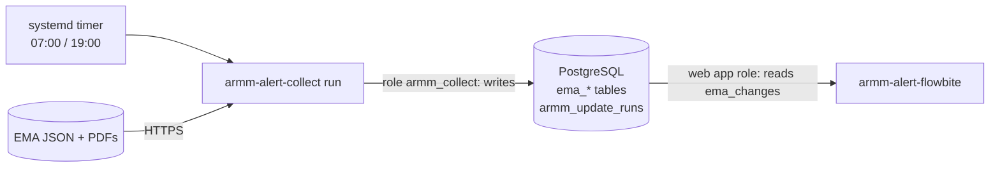

# armm-alert-collect: design

Status: proposal 

Related:
- [data-model.md](data-model.md): the columns of every table named here,
- armm-alert-flowbite [armm-database.md](../../armm-alert-flowbite/docs/armm-database.md),
- [plan.md §2.1](../../armm-alert-flowbite/docs/plan.md#21-armm-database-blocks-step-6),
- [`src/routes/tools/armm-alert-ema/design.md`](../../marcelvenema.com-flowbite/src/routes/tools/armm-alert-ema/design.md)

armm-alert-collect is the **update process** that aRMM Alerts (armm-alert-flowbite, "the web app") reads from.
Twice a day it downloads the public data, stores the current state in the **aRMM database**, and records
every change customers should see in **`ema_changes`**, which the web app reads directly. The collector never
talks to customers.

## 1. Scope

- **EMA JSON**: the medicines file and the EPAR documents file, every human and veterinary product, any status.
  Changes to product information (SmPC/PIL) and to the RMP (aRMM) are what customers are alerted about.
- **PDF archive**: every new version of a monitored document is downloaded and stored, because EMA
  overwrites the PDF at the same URL. Stored in PostgreSQL (§4.3).
- A **change log** (`ema_changes`) and a **run record** (`armm_update_runs`), so the web app knows what changed
  and when the last update was.

## 2. Overview



- One **CLI**, started by a **systemd timer**, separate from the web process. No daemon, no UI.
- **TypeScript on Node 24**, the same stack and conventions as the web app (`pg`, migrations in code, no build
  step: Node runs `.ts` directly).
- The aRMM database is the same PostgreSQL database as the web app's. The collector writes the `ema_*` tables
  and `armm_update_runs`; the web app only reads them.

## 3. Sources

### 3.1 Source modules

Other sources will follow, but which ones isn't known yet, so every source is a module with the same shape:

```ts
interface Source<Snapshot> {
	id: string; // 'ema'
	/** Download and validate. No database writes. Throws on a malformed response. */
	fetch(ctx: FetchContext): Promise<Snapshot>;
	/** The source's own version stamp, e.g. EMA's meta.timestamp. Same as last time → skip. */
	version(snapshot: Snapshot): string | null;
	/** Compare with the stored state and write it, inside the run's transaction. */
	apply(tx: Tx, snapshot: Snapshot, run: RunContext): Promise<ApplyResult>;
	/** Optional work after apply, outside the transaction (e.g. PDF downloads). */
	afterApply?(db: Db, run: RunContext): Promise<AfterResult>;
}
```

- A source owns its own tables, prefixed with its id (`ema_*`).
- A source records changes only through `recordChange()`, which writes `ema_changes` (§4.2). This keeps the
  shape of a change the same for every source.
- One source failing never stops the others (§5).

### 3.2 EMA

| File | URL | Size (26-10-2026) |
| --- | --- | --- |
| Medicines | `https://www.ema.europa.eu/en/documents/report/medicines-output-medicines_json-report_en.json` | 2,754 records, ~6.8 MB |
| EPAR documents | `https://www.ema.europa.eu/en/documents/report/documents-output-epar_documents_json-report_en.json` | 20,317 records, ~29 MB |

EMA updates both twice a day, at 06:00 and 18:00 Amsterdam time. How each field is stored is in
data-model.md §4.1 (`ema_products`) and §4.2 (`ema_documents`).

**Validation.** `data` must be an array and `meta.total_records` must equal its length. A file with fewer
than 90% of the records of the last good run also fails, so that a truncated export never marks thousands of
documents as removed.

**Monitored types.** Which document types are monitored and archived is in data-model.md §4.2 ("Document
types"): `product-information`, `rmp` and `rmp-summary` are monitored; `product-information-tracked-changes`
is archived too. It's a constant in `src/sources/ema/types.ts`. A `type` that isn't in that list is stored as
unmonitored and logged as a warning, so a new EMA type is noticed instead of silently ignored.

## 4. Database

Conventions and columns: [data-model.md](data-model.md). Source records keep the source's own key
(`ema_product_number`, EMA document `id`).

### 4.1 Roles

| Role | Rights | Used by |
| --- | --- | --- |
| `armm_collect` | `SELECT`, `INSERT`, `UPDATE` on the `ema_*` tables and `armm_update_runs`; `DELETE` on `ema_changes` only (retention). No rights on the web app's other tables. | This tool (`DATABASE_URL`). |
| The web app's role | `SELECT` on the `ema_*` tables and `armm_update_runs`. | The web app. |

So the collector can't touch customer data, and the web app can't change EMA data: the read-only access asked
for in armm-database.md §3.

### 4.2 Runs and changes

**`armm_update_runs`** (data-model.md §5.1): one row per source per run that found new data.

| Column | Filled by the collector with |
| --- | --- |
| `source_run_id` | The source and its version stamp, e.g. `ema:medicines=2026-10-26T06:02:46Z;documents=2026-10-26T05:50:10Z`. Unique, so the same EMA export is never processed twice. |
| `status` | `processing` while the source runs, then `done` or `failed`. `pending` isn't used. |
| `run_finished_at` | When the source's transaction committed. |
| `change_count` | Rows in `ema_changes` for this run. |
| `error` | When `failed`. |
| `attempts` | 1, plus one for every retry of the same `source_run_id` after a failure. |
| `started_at` / `finished_at` | When the collector processed it. |

A run where EMA had nothing new (same version stamp) writes **no** row: it's logged and skipped. A new row
therefore appears every time EMA publishes, normally twice a day, so the web app's "no run for 14 hours" alarm
(armm-database.md §4) fires both when the collector is broken and when EMA stops publishing.

**`ema_changes`** (data-model.md §4.3): one row per change that customers can see.

- Written in the **same transaction** as the source's data and as the run's `done` status. A change is never
  visible without its run, and a run is never `done` without all its changes.
- `update_run_id` → the run above. Unique on `(update_run_id, entity_type, entity_ref, change_type)`.
- `changed_at` is the run's `run_finished_at`. When the change happened at EMA (`last_updated_date`) is in
  `details`.
- **Baseline isn't logged.** The first run sees ~23,000 records that are all "new". They're stored as history
  (`version_kind = 'baseline'`, data-model.md §4.4) but don't go into `ema_changes`, so customers don't get
  23,000 alerts on day one.
- Only **monitored** changes are logged (§3.2). The rest is kept in the `ema_*` history only.
- Kept for **7 years** (data-model.md §9).

**What goes into `ema_changes`**

| Event | `entity_type` | `change_type` | Logged when |
| --- | --- | --- | --- |
| New document version | `ema_document` | `created` (new id) or `updated` | The type is monitored. |
| Document gone from the feed | `ema_document` | `deleted` | The type is monitored. |
| Product fields changed | `ema_product` | `updated` | A **tracked** field changed (data-model.md §4.1). One row per product per run, all fields in `details.fields`. |
| New product | `ema_product` | `created` | Always (after the baseline). |
| Product gone from the feed | `ema_product` | `deleted` | Always. |

`entity_ref` is the `ema_product_number` or the EMA document `id`. `title` is e.g. `Padcev: SmPC / PIL
updated`; `summary` e.g. `Product information updated on 16-10-2026 (procedure VR/0000336191).` `details`
for a document also holds `product_number`, `product_name`, `type`, `document_version_id`,
`last_updated_date` and `document_url`, so the web app can show and link it without joining the other EMA
tables.

### 4.3 EMA tables and the archive

| Table | Holds | data-model.md |
| --- | --- | --- |
| `ema_products` | Current state of each medicine. | §4.1 |
| `ema_documents` | Current state of each document. | §4.2 |
| `ema_document_versions` | One row per detected version of a document, kept forever. | §4.4 |
| `ema_document_files` | The archived files (PDF, sometimes Word or Excel), kept forever. | §4.5 |

Product field changes aren't kept in a separate table: they're in `ema_changes.details.fields`.

## 5. A run

```sh
node --env-file=.env src/cli.ts run [--source=ema] [--force] [--no-pdf]
```

### 5.1 Steps

1. **Lock.** `pg_try_advisory_lock` on a fixed key. If another run holds it, log and exit `0`: runs never
   overlap, even when a manual run meets the timer.
2. **Migrate.** Apply pending migrations (same approach as the web app's `migrations.ts`).
3. **Per source**, in order:
   1. `fetch()` with a timeout and 3 retries with backoff. Validate (§3.2).
   2. If `ema:<version>` is already in `armm_update_runs` as `done` and `--force` isn't given: log `skipped`,
      go to the next source. (`--force` adds `;forced=<time>` to `source_run_id`.)
   3. Insert or update the `armm_update_runs` row as `processing` (`attempts + 1` if it already existed as
      `failed`).
   4. In **one transaction**: `apply()` (upserts, diff, version rows, `recordChange()`), then set the run to
      `done` with `change_count` and `run_finished_at`.
   5. On any error: roll back, set the run to `failed` with the error, go on with the next source.
4. **After apply** (`afterApply()`, outside the transaction): the PDF archive (§5.2). Failures here are logged
   and recorded per version (`file_error`), never a failed run, because the changes themselves are already
   correct.
5. **Exit** `0` when no source failed, `1` otherwise, so systemd marks the unit as failed.

The `processing` and `failed` statuses are written outside the source transaction, so a failure is always
visible in `armm_update_runs`.

### 5.2 PDF archive

For every `ema_document_versions` row with `file_sha256 is null` and no `file_error`, of an archived type:

- **Only while it's still current.** EMA overwrites the file at the same URL, so a version is only downloaded
  while the document's current `last_updated_date` still equals the version's. A version that was overtaken
  before it could be downloaded gets `file_error = 'superseded'` and is never retried. Otherwise a retry would
  store the wrong version.
- At most 4 downloads at a time, 3 retries each, 60 s timeout.
- Hash the bytes, `insert … on conflict (sha256) do nothing` into `ema_document_files`, then set `file_sha256`
  on the version. A failed download sets `file_error`, and is tried again on the next run as long as the
  version is still current.
- `--no-pdf` skips this step. The versions are picked up by the next run, as long as they're still current.

### 5.3 First run

The first run, or the first run of a new source, is the **baseline**: everything is stored, every version
gets `version_kind = 'baseline'`, and nothing goes into `ema_changes`. The run is `done` with
`change_count = 0`. Files of the current archived documents **are** downloaded: ~4,000 files (on 26-10-2026:
2,221 PI, 797 RMP, 679 RMP summary, 330 tracked changes), about 4–8 GB, once. So the baseline download is
spread out: at most 500 per run, oldest products first, until done.

### 5.4 Retention job

Once a day, after a run: `delete from ema_changes where created_at < now() - interval '7 years'`. Nothing
else is ever deleted (data-model.md §9).

## 6. Contract with the web app

This answers the aRMM questions in the web app's [plan.md §2.1](../../armm-alert-flowbite/docs/plan.md#21-armm-database-blocks-step-6):

| Question | Answer |
| --- | --- |
| What can the update process provide? | A change log, `ema_changes`, with one `armm_update_runs` row per update. A change is only there once its run is `done`. |
| When do the runs happen? | 07:00 and 19:00 Amsterdam time, one hour after EMA's update. A normal run takes a few minutes. |
| How does the web app reach the database? | Same PostgreSQL database; the web app's role has `SELECT` on the EMA tables. |
| What's in the database? | EMA medicines and documents. `entity_type` is `ema_product` or `ema_document`. Title and summary are written by the collector. |

**What changes for the web app.** It no longer processes runs itself (the "processing a run" steps of
armm-database.md §2): it reads `ema_changes` directly, newest first, and shows "Last update" from the latest
`done` row in `armm_update_runs`. Its own `armm_changes` table is replaced by `ema_changes`, and its
`armm_update_runs` is now written by the collector.

**Archived PDFs.** The web app can serve them from `ema_document_files` through `ema_document_versions`,
behind sign-in. Whether customers get to see them is a web app decision.

**Rules for changing the contract.** `armm_update_runs`, `ema_changes`, `ema_document_versions` and
`ema_document_files` are the public interface. Columns are only ever added; renaming or removing one needs a
change in the web app first.

## 7. Scheduling and operations

`deploy/systemd/armm-alert-collect.service` (`Type=oneshot`, a dedicated system user, `EnvironmentFile`) and
`armm-alert-collect.timer`:

```ini
[Timer]
OnCalendar=*-*-* 07,09,19,21:00:00 Europe/Amsterdam
Persistent=true
RandomizedDelaySec=120
```

- The 09:00 and 21:00 runs are **catch-up runs**: when EMA was late, the 07:00 run found nothing new and this
  one gets the update. When EMA was on time, they find nothing new either. A run without new data is cheap
  (two downloads, no writes).
- `Persistent=true` makes a missed run happen after the server comes back up.
- **Logs** go to journald as one JSON line per event (`run.started`, `source.done`, `source.skipped`,
  `pdf.failed`, `ema.unknown_type`, …). There is no personal data in this tool, but the database URL is never
  logged.
- **Monitoring** stays in the web app (armm-database.md §4: no `done` run for 14 hours → email). The collector
  sends no email in version 1, so `RESEND_API_KEY` and `AUTH_EMAIL_FROM` can be removed from `.env`.
- **Manual commands:**
  - `src/cli.ts run --force`: re-import even if EMA's timestamps didn't change.
  - `src/cli.ts status`: the last runs.
  - `src/cli.ts pdf --retry`: retry archive downloads only.

## 8. Project layout

```
armm-alert-collect/
  src/
    cli.ts                   argument parsing, commands
    run.ts                   the run loop (§5.1)
    changes.ts               recordChange() → ema_changes
    retention.ts             §5.4
    log.ts
    db/
      index.ts               pool, transactions, advisory lock
      migrations.ts          numbered SQL migrations for the ema_* tables, incl. grants
    sources/
      types.ts               Source interface (§3.1)
      index.ts               enabled sources, in order
      ema/
        fetch.ts             download + validate
        types.ts             monitored and archived document types
        map.ts               mapProduct etc. (ported from the prototype)
        apply.ts             diff, versions, changes
        pdf.ts               archive (§5.2)
  test/
    fixtures/ema/            small medicines/documents files, before and after
    ema.apply.test.ts        node:test against a throwaway database
  deploy/systemd/
  docs/design.md, docs/data-model.md
  .env.example
```

Dependencies: `pg` only. Node's built-in `fetch`, `crypto`, `node:test` and `parseArgs` cover the rest.

**Tests** run `apply()` twice against fixtures (baseline, then a changed snapshot) and check the version rows
and the exact `ema_changes` rows: new, updated, removed, an orphan document, an unknown type, a truncated
file. They run against a real PostgreSQL in a database created per test run.

## 9. Sizes and backups

| What | Size |
| --- | --- |
| EMA tables incl. `raw` | ~100 MB, growing slowly |
| `ema_changes` | ~150 rows a week |
| Files, baseline | 4–8 GB once |
| Files, ongoing | 5–8 GB a year |

**Retention: versions and files are kept forever.** EMA keeps no history and overwrites its files, so the
document versions and archived files are the only copy; nothing deletes them. The database therefore only
grows, by 5–8 GB a year. The changes customers see (`ema_changes`) are kept for 7 years, and the update runs
they refer to forever (data-model.md §9).

The files make the database much larger than the web app's own data. A daily `pg_dump` of everything will get
slow. Options: dump `ema_document_files` separately and less often (it's append-only, so an incremental copy
works), or use `pg_basebackup` with WAL archiving. See §11.

## 10. Phases

1. **Collector core.** Tables, roles, run loop, EMA source, `ema_changes`, retention job, systemd timer,
   tests. After this the web app can build step 6 of its plan.
2. **PDF archive.** `ema_document_files`, the archive step, the spread-out baseline download.
3. Later, each with its own design: the parallel distribution register as a second source, the PI section
   diff, national sources.

## 11. Open questions

1. **Which changes are customer-visible?** This design logs only monitored types (PI and RMP) and the tracked
   product fields. Should status changes (e.g. *Authorised → Withdrawn*) or new products be logged as well,
   or kept out of `ema_changes`?
2. **Backups** of 5–8 GB of files a year in PostgreSQL (§9): which approach, and where to?
3. **Other sources.** Which national sources (e.g. the Dutch CBG-MEB) should follow, and do they have an export?
4. **Prototype.** When can the prototype import on marcelvenema.com be switched off?
